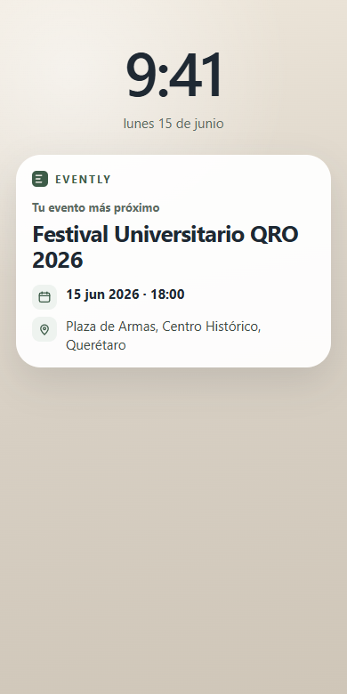
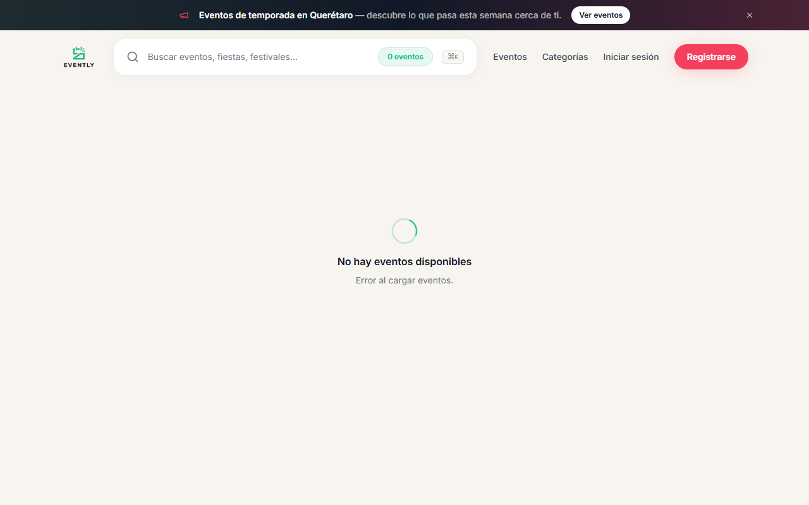
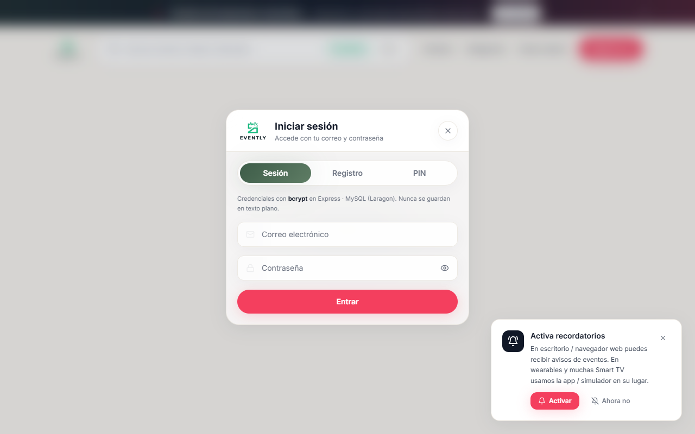
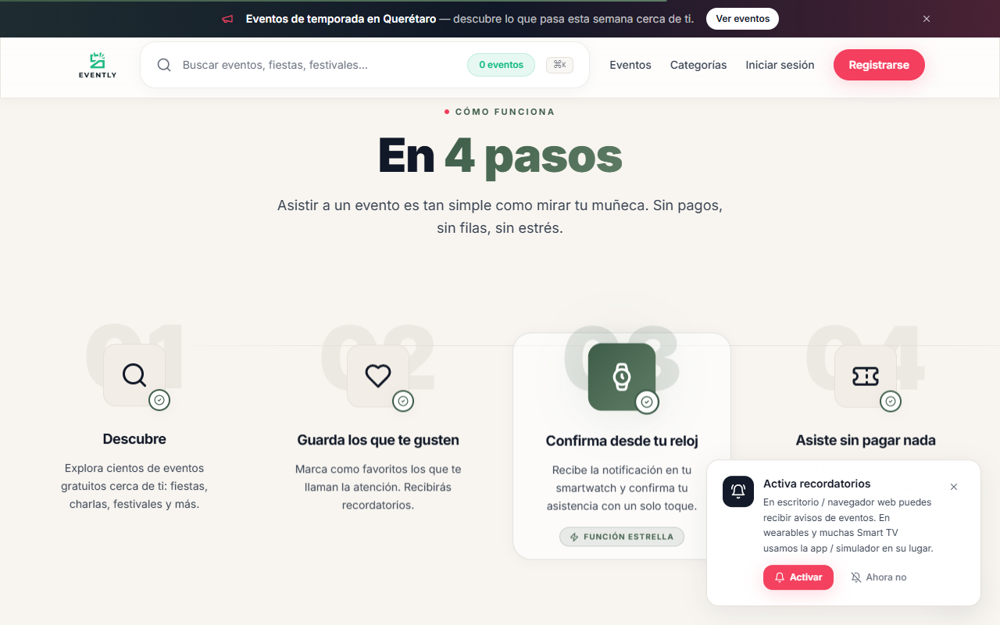
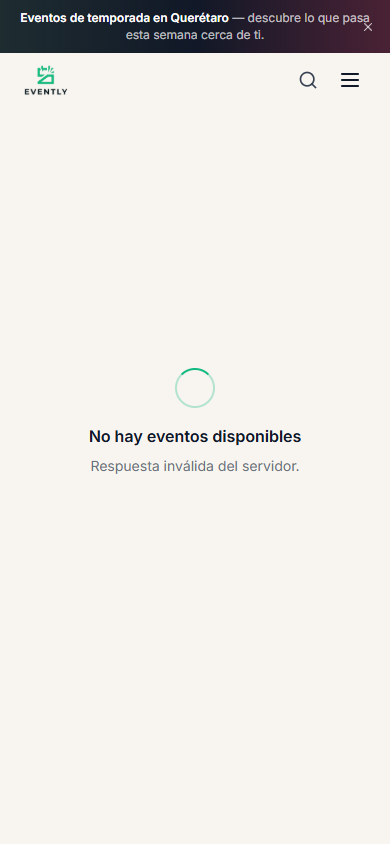
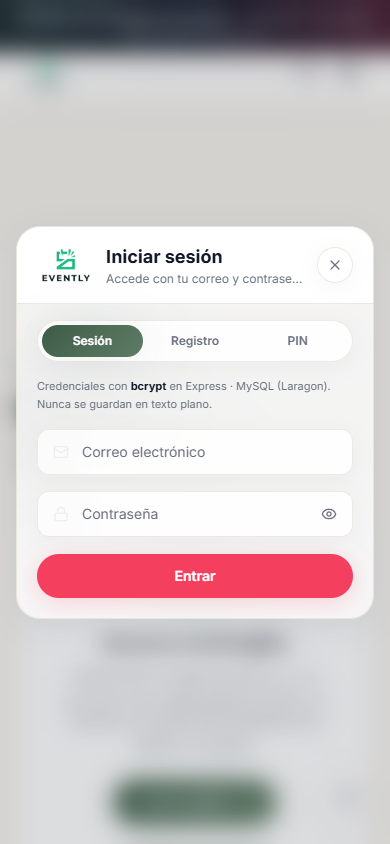
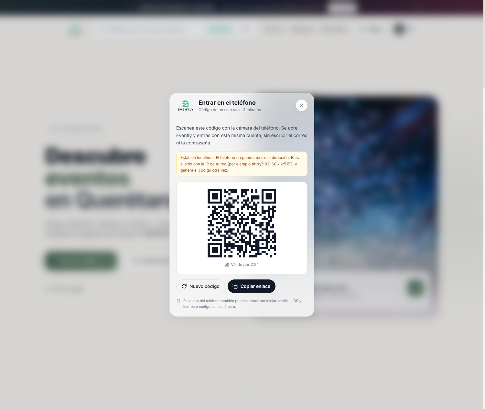

# Evently — Preguntas y entregas

Materia: Dispositivos inteligentes

---

# Preguntas

## 1.- ¿Qué framework móvil seleccionas y describe los criterios por los cuales lo seleccionaste?

**Respuesta:**

El framework de la aplicación móvil es **React**, con **JavaScript**. **Flutter** se usa únicamente en el smartwatch.

Criterios de selección:

1. **Mismo lenguaje que el sitio.** Evently ya está desarrollado en React, así que la app móvil continúa en ese mismo lenguaje y se conecta a la misma API.

2. **Reutilización de lo ya hecho.** Se pueden aprovechar los componentes, el cliente de la API y la autenticación que ya existen en el sitio.

3. **Pensada para el teléfono.** La interfaz del sitio ya se adapta a pantalla pequeña e incluye la opción de instalarse en el dispositivo.

4. **Inicio de sesión con código QR.** La web en React genera el código de una sesión activa y la app móvil, también en React, lo lee para entrar. Ya está en el sitio: con la sesión iniciada, el menú **Entrar en el teléfono** muestra ese código.

5. **Huella dactilar.** Al abrir la app móvil se solicita la huella del dispositivo para desbloquear el contenido.

6. **El reloj queda aparte.** El smartwatch sigue en Flutter, en su propio proyecto, y no forma parte de la app móvil.

## 2.- ¿Cómo piensas implementar el framework alrededor de tu proyecto en Flutter?

**Respuesta:**

La aplicación móvil se implementa en **React**, alrededor del sitio y de la API que ya existen. **Flutter** permanece solo en el smartwatch.

Organización:

- **Sitio web:** React, con las pantallas de eventos, registro, inicio de sesión y confirmación de asistencia.
- **App móvil:** también en React. Desde ahí se escanea el código QR y se pide la huella.
- **Smartwatch:** proyecto aparte en Flutter. Solo muestra los eventos en el reloj.

Implementación del flujo:

1. El usuario inicia sesión en la versión web de Evently.
2. En el menú de la cuenta, con **Entrar en el teléfono**, la web genera un código QR de un solo uso, válido 3 minutos, asociado a esa sesión.
3. La app móvil en React lee el código QR, con la cámara del teléfono o desde Iniciar sesión → QR, y recupera la sesión.
4. La sesión queda guardada en el dispositivo.
5. Cada vez que se abre la app móvil, se solicita la huella antes de mostrar el contenido.
6. Con la sesión desbloqueada, la app consulta los eventos y permite confirmar la asistencia, usando los mismos datos que el sitio web.

El código QR, que la web muestra en **Entrar en el teléfono**, vincula el teléfono con una sesión que ya existe en la web. La huella desbloquea esa sesión cada vez que se abre la aplicación móvil. El reloj en Flutter solo consulta esos mismos eventos.

## 3.- ¿Saber si está orientado a objetos o a funcionalidad?

**Respuesta:**

La aplicación móvil está **orientada a la funcionalidad**.

React organiza la interfaz en componentes de función. El estado de la pantalla, de la sesión y de los eventos se maneja con funciones y con los hooks de React. Las pantallas del sitio, como la página principal, el inicio de sesión y el detalle del evento, están escritas de esa forma.

El smartwatch está **orientado a objetos**, porque Flutter organiza cada pantalla en clases. Ese desarrollo queda únicamente en el reloj.

En resumen, la app móvil de Evently se implementa en React con un enfoque funcional, y el reloj se mantiene en Flutter con un enfoque orientado a objetos.

## 4.- Tipo de gestionamiento de almacenamiento en mi app

**Respuesta:**

Evently usa dos tipos de almacenamiento: uno en el dispositivo y otro en el servidor.

**En el dispositivo**

1. **localStorage.** Guarda la sesión de forma permanente en el teléfono o en el navegador. Ahí quedan el token y los datos del usuario cuando se elige recordar la sesión. También se guarda el enlace con el dispositivo. Esos datos siguen disponibles aunque se cierre la aplicación.

2. **sessionStorage.** Guarda información solo durante la visita. Si no se elige recordar la sesión, el token vive aquí y se pierde al cerrar la pestaña. Los avisos que el usuario ya cerró, como el de notificaciones o el de instalación, también se guardan aquí para no volver a mostrarlos en la misma visita.

Al cerrar sesión se borran el token y el usuario tanto de `localStorage` como de `sessionStorage`.

**En el servidor**

Los eventos, los usuarios, las contraseñas y las confirmaciones de asistencia se guardan en **MySQL**. La app móvil no copia esa base en el teléfono: consulta esos datos por la API y en el dispositivo solo conserva la sesión.

## 5.- ¿Qué clase de widget va a tener tu app móvil?

**Respuesta:**

La app móvil va a tener un widget de información en la pantalla de inicio. Esa clase muestra unos pocos datos importantes sin abrir la aplicación, sin una lista para desplazarse y sin botones de control. Se usa porque lo que hace falta ver de un vistazo es un solo evento: el confirmado que ocurre antes que los demás, con su nombre, su fecha, su hora y su dirección.

El widget consulta los eventos de la sesión y se queda con el de fecha más cercana. Si no hay ninguno pendiente, indica que no hay un evento próximo. En el ejemplo, el más cercano es el Festival Universitario QRO 2026.

**Figura 6.** Así debe quedar el widget en el teléfono: evento más próximo, con fecha y dirección.

## 6.- ¿Qué tipo de interfaz tiene la app?

**Respuesta:**

La interfaz de la aplicación es de **tipo americano**.

Se caracteriza por una presentación limpia y directa: poco ruido visual, jerarquía clara (título, texto de apoyo y acción), espacios amplios entre bloques y controles fáciles de reconocer. En Evently la pantalla principal muestra el contenido principal de inmediato (eventos, búsqueda e inicio de sesión), con botones y enlaces visibles, sin saturar la vista con menús densos ni con demasiada información al mismo tiempo.

Ese estilo encaja con una app pensada para usarse en el teléfono: el usuario encuentra rápido qué hacer (ver eventos, entrar o confirmar asistencia) sin recorrer una interfaz cargada.

## 7.- ¿Qué tipo de navegación tiene la app?

**Respuesta:**

La navegación de la aplicación es de tipo **scrolling**.

El contenido principal se recorre desplazando la pantalla de arriba hacia abajo. En la página de inicio las secciones (presentación, cómo funciona, listado de eventos y demás bloques) quedan en una misma vista continua; el usuario avanza haciendo scroll, en lugar de depender solo de pestañas o de una barra inferior para cambiar de pantalla.

Los enlaces del menú llevan a puntos de esa misma página o a pantallas concretas (inicio de sesión, detalle de evento), pero el patrón base de la app móvil es el desplazamiento vertical para descubrir y consultar la información.

---

# Entregas

## Entrega 1. Sitio web desarrollado y funciones actuales

El sitio web desarrollado se llama **Evently**. Es una plataforma de asistencia a eventos en la que se pueden publicar eventos, conferencias y otros tipos de actividades. Los usuarios pueden registrarse en los eventos publicados y confirmar su asistencia. Además, permite visualizar los eventos desde un dispositivo inteligente tipo reloj (smartwatch).

### Evidencia

Esta parte ya está hecha. Las siguientes capturas son del sitio Evently en funcionamiento.

**Figura 1.** Página de inicio, con buscador, acceso a eventos, inicio de sesión y registro.

**Figura 2.** Inicio de sesión ya implementado, con acceso por correo, registro y PIN.

**Figura 3.** Funciones actuales del sitio: descubrir eventos, guardarlos, confirmar asistencia desde el reloj y asistir.

En el teléfono, la misma aplicación muestra la página principal y el inicio de sesión.

**Figura 4.** Página principal en el teléfono, con buscador, menú y acceso a eventos.

**Figura 5.** Inicio de sesión en el teléfono, con correo, contraseña, registro y PIN.

## Entrega 2. Inicio de sesión mediante código QR — Hecho

Esta entrega ya está en el sitio. Con la sesión iniciada, el menú de la cuenta muestra **Entrar en el teléfono**. Ahí aparece un código QR de un solo uso, válido 3 minutos. El código no lleva la contraseña ni el token: es un enlace temporal que la API canjea una sola vez.

La aplicación móvil es la misma app en React. En el teléfono se entra de dos maneras: escaneando el QR con la cámara del sistema, que abre Evently con la sesión, o dentro de Iniciar sesión, en la pestaña QR, leyendo el código con la cámara de la app.

1. El usuario inicia sesión en la versión web de Evently.
2. En el menú elige **Entrar en el teléfono**. La web pide el código a la API y lo muestra como QR.
3. El teléfono escanea ese código, con la cámara del sistema o desde la pestaña QR de la app.
4. La API entrega la sesión de esa cuenta, guarda el token en el teléfono y marca el código como usado.

Si el código expira o ya se usó, la web genera otro. Así el teléfono queda vinculado a la sesión que ya existía en el sitio, sin volver a escribir correo y contraseña.

**Figura 7.** Código QR de la sesión web para entrar en el teléfono.

## Entrega 3. Autenticación biométrica (huella dactilar)

Para poder acceder a la aplicación móvil, el usuario deberá autenticarse mediante su huella dactilar, utilizando el sensor de desbloqueo del dispositivo.

Después del primer acceso con el código QR, cada vez que se abra la aplicación se solicitará la huella. Si la huella coincide con la del dispositivo, se muestra el contenido de Evently.

La huella protege el acceso local de la app móvil. El smartwatch, desarrollado en Flutter, queda fuera de este flujo y solo sirve para consultar los eventos desde el reloj.

---

# Prácticas

## Práctica 1. Introducción al firmware mediante script — No aplica

La práctica desarrolla un script de firmware para un ESP32 que controla un LED y lee el estado de un botón, para entender la interacción entre el software y los componentes físicos del dispositivo.

Evently no programa un microcontrolador ni controla hardware de ese tipo. El proyecto vive en el sitio web (React), en la aplicación móvil y en el smartwatch (Flutter). La interacción es con pantallas, sesión, eventos y la API; no con un LED ni un botón físico cableado a un ESP32. Aunque la práctica sea de firmware y no de IoT con sensores remotos, el entregable exige un circuito y un script que Evently no incluye. Por eso esta práctica no forma parte del proyecto.

## Práctica 2. Consumo de una URL preasignada (ConsultaWeb) — Sí aplica

Evently no trae los eventos escritos en el código. Los pide a una URL ya definida, la de la API del sitio (por ejemplo el listado de eventos). Esa dirección está separada de la pantalla. Al consultar, la aplicación hace una petición HTTP, procesa la respuesta (JSON) y la muestra. Mientras espera, indica que está consultando. Si no hay conexión, avisa que no fue posible obtener la información y no presenta datos a medias.

Es la misma técnica de ConsultaWeb como extensión del sitio personal: URL preasignada, solicitud HTTP y procesamiento de la respuesta. En Evently se usa para cargar eventos, sesión y confirmaciones de asistencia.

## Práctica 3. Almacenamiento estructurado (SQLite / Room) — Sí aplica

En el teléfono la información se guarda con campos fijos, no como un texto suelto. La sesión ya funciona así: el token y los datos del usuario quedan en el dispositivo (`localStorage` / `sessionStorage`) y siguen ahí al cerrar la aplicación. La práctica lleva esa idea a una base local estructurada (SQLite mediante Room): entidad, DAO y operaciones para registrar, consultar, modificar y eliminar, por ejemplo una tabla de usuarios.

MySQL sigue siendo la base compartida del servidor. En el dispositivo queda la copia estructurada que la app necesita sin depender solo de la red. Si la tabla gana un campo, cambian la entidad, la base, la interfaz y las operaciones de inserción, consulta y actualización. Por eso esta práctica sí aplica al proyecto.

## Práctica 4. Código seguro en aplicaciones móviles (AccesoSeguro) — Sí aplica

Evently tiene inicio de sesión con correo y contraseña (y PIN). La práctica de AccesoSeguro exige validar que los campos no vayan vacíos, limitar la longitud de las entradas, ocultar la contraseña, mostrar errores genéricos sin datos sensibles y no imprimir credenciales en Logcat.

Eso aplica directamente al acceso de Evently: si la app aceptara entradas sin validar, revelara detalles técnicos en errores o escribiera contraseñas en el registro, pondría en riesgo la sesión y los datos del usuario. Las medidas de AccesoSeguro (validación, manejo seguro de credenciales y mensajes genéricos) son las mismas que el login de Evently debe cumplir. Por eso esta práctica sí aplica.

## Práctica 5. Interacción entre dispositivos (MobileConnect) — Sí aplica

La práctica busca comprender cómo dos dispositivos intercambian información de forma inalámbrica: un mensaje enviado desde uno aparece en el otro.

En Evently esa interacción ya existe entre varios dispositivos del mismo sistema:

1. **Web y teléfono.** Con la sesión iniciada, la web muestra en Entrar en el teléfono un código QR de un solo uso; la app móvil lo lee y recupera esa sesión sin volver a escribir correo y contraseña.
2. **Teléfono y smartwatch.** El reloj consulta por la API los mismos eventos y permite ver o confirmar asistencia desde Wear OS.

No es un chat entre dos teléfonos como MobileConnect, pero el objetivo de la práctica —intercambio de información entre instancias o dispositivos por un canal inalámbrico— es el mismo: la sesión viaja del sitio al móvil, y los eventos se comparten con el reloj. Por eso esta práctica sí aplica al proyecto.
